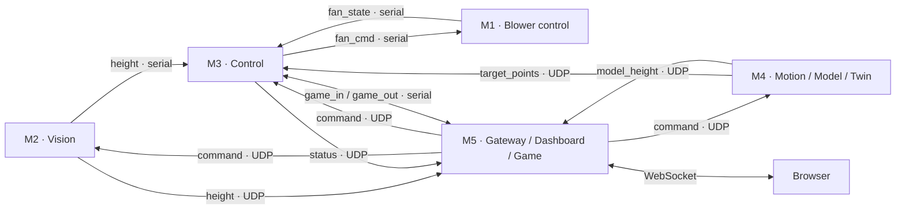

# Ultrasonik

**Vision-based ping-pong ball levitation and control system**  
CSE396 — Computer Engineering Project, Gebze Technical University | Team Ultrasonik

> Status: repository scaffold. Module implementations, verified test results and the frozen protocol are not yet included.

## Project overview

A 40 mm ping-pong ball is suspended in a transparent vertical tube approximately 1 m long using controlled airflow. A camera estimates the ball height, a control board computes the requested blower speed, and a separate blower controller regulates speed and enforces safety. The planned modes are hold, sine wave, asymmetric wave and obstacle game. A browser dashboard provides live parameters and plots; a 3D digital twin visualizes the rig.

## System architecture



The essential real-time chain is M2 → M3 → M1. Network loss should not interrupt the local control loop; M3 holds its last target. A missing new real height for 200 ms causes M3 to command the blowers off; M1 shuts off its outputs after 100 ms without a new valid fan command. Hardware watchdog and emergency stop provide additional independent safety paths. These are design requirements, not verified results.

## Modules and teams

| Module | Responsibility | Planned stack | Team |
| --- | --- | --- | --- |
| [M1](modules/m1-blower-control/) | Blower speed loop, limits, faults, characterization | C++, PlatformIO, Python | Efe, Ümit, Ömer, Hamdi |
| [M2](modules/m2-vision-estimation/) | Detection, calibration, height and velocity estimation | Python, OpenCV, NumPy | Ömer, Hamdi, Rüya, Yusuf Batuhan |
| [M3](modules/m3-control-firmware/) | Height PID, state machine, target buffer, HIL | C++, PlatformIO, Python | Rüya, Yusuf Batuhan, Adem, Umutcan |
| [M4](modules/m4-motion-model-twin/) | Trajectories, plant fitting, digital twin | Python, SciPy, TypeScript, Three.js | Adem, Umutcan, Mustafa, Mert |
| [M5](modules/m5-gateway-dashboard-game/) | Message contract, gateway, logging, dashboard, game | Python, TypeScript, C++, uPlot | Mustafa, Mert, Efe, Ümit |

## Repository guide

```text
Ultrasonik/
├── modules/                 # Five independent functional modules
├── shared/contract/         # Versioned interfaces, codecs and test vectors (M5)
├── hardware/                # Physical platform, BOM, wiring and H1–H9 checks
├── tests/integration/       # Cross-module and complete-system tests
├── config/                  # Shared example environment settings
├── docs/                    # Project documents, decisions and meeting notes
├── .github/                 # Issue/PR templates and planned CI workflows
├── CONTRIBUTING.md          # Team development workflow
└── README.md
```

Each module has its own README, source area, tests, stand-ins, configuration and evidence directory. Firmware projects should keep PlatformIO configuration at their own project root. Split mixed-language modules into appropriate subprojects when implementation begins.

**Dependency rule:** No module imports another module's implementation or needs another running module for its stand-alone tests. The shared message contract is the only common code/interface dependency; mock partners and synthetic data belong to the module under test. Hardware is a platform, not a sixth module. M1 characterization data and M4 model parameters are offline handoffs; synthetic/default data allow parallel development.

## Getting started

After receiving repository access:
```bash
git clone https://github.com/GTU-Ultrasonik/Ultrasonik.git
cd Ultrasonik
git switch main
git pull --ff-only
git switch -c feat/m2-example
```
Replace the example branch with your assigned task. Read the relevant module README and [CONTRIBUTING.md](CONTRIBUTING.md) before writing code. Each module team must document its own install, run and test commands once implemented. There is no working system-wide launch command yet.

Planned environments: Python 3.11+, pinned dependencies, PlatformIO for firmware, and current Chrome/Firefox for browser components. Use configuration files for camera indexes, serial ports and network settings; use portable paths and monotonic clocks. Windows and Linux are both required.

## Testing and evidence

Every module has 13 requirements in the project documentation. Use IDs R1.1–R5.13 and matching T identifiers in issues, tests, commits/PRs and reports. Hardware checks H1–H9 and integration tests are tracked separately.

| Level | Meaning | Evidence |
| --- | --- | --- |
| S | Stand-alone, no other module or rig; own MCU allowed | Unit tests, synthetic data, simulation, HIL where applicable |
| B | Bench test with own hardware/instrument | Measured values, instrument logs and plots |
| R | Full rig / real module integration | System measurements and demo evidence |

Each module must provide one documented test command and a report containing requirement ID, expected limit, actual value, pass/fail and relevant plots. Record environment, commit, test data and whether results are simulated or measured. Planned CI runs software tests on Windows and Ubuntu for pull requests; physical bench/rig results are collected separately. No passing tests or CI badges are claimed at scaffold stage.

## Project milestones

- December 4, 2026: stand-alone module demonstrations (S tests; B tests if parts are available).
- December 30, 2026: final integrated project demonstration.

See the November 2026 *Project and Module Documentation* (38 pages), especially sections 2, 4–9 and 10–11, for authoritative requirements and provisional thresholds. The PDF is not yet uploaded to this repository; [docs/](docs/) describes where to place it.

## Contributing

Use task-specific branches, small commits, pull requests and peer review. Do not silently change the protocol or safety limits. See [CONTRIBUTING.md](CONTRIBUTING.md). Repository structure is a team convention, not a change to the five-module design.
